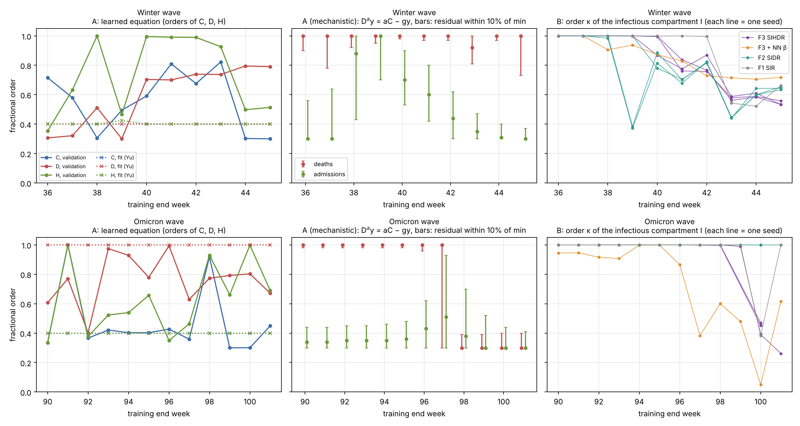

# Is the memory real? Fractional models for COVID-19 forecasting – identifiability tests

Joint work of **Waseem Shokat** and **Dr He Li** (University of Georgia), 2026.

We ask whether fractional (memory) derivatives improve COVID-19 forecasts, and whether the
fractional order can be identified from real surveillance data. All experiments use weekly
California data (cases, deaths, hospital admissions) and the rolling-window forecasting set-up
(1–4 weeks ahead) of Qian et al., *Physics-informed deep learning for infectious disease
forecasting* (arXiv:2501.09298, 2025).

## Experiments

| Script (in `code/`) | What it does |
|---|---|
| `fpinn_qian.py` | Fractional extension of the Qian et al. PINN: d/dt replaced by a Caputo derivative of learned order (L1 scheme); optional recursive 1-week updating |
| `fde_discovery.py`, `fde_core.py` | Experiment A: learn a fractional ODE directly from the data (sparse regression + search over the orders, following Yu et al., arXiv:2412.03970) |
| `fde_real2.py` | Revised Experiment A: smoothing spline, the fit criterion of Yu et al. with a BIC penalty, and a mechanistic equation D^α y = aC − gy for deaths and admissions |
| `synth_test.py`, `synth_test2.py`, `synth_smooth.py` | Synthetic tests with a known order: does the method recover it? |
| `kh_fpinn.py` | Experiment B: the fractional models F1 (SIR), F2 (SIDR), F3 (SIHDR) of Kharazmi et al. (Nat. Comput. Sci. 2021), variable-order Caputo derivatives, fitted with a PINN |
| `compare2.py`, `seedstats.py`, `mk_tseeds.py` | Forecast errors (MAE, RMSE, peak timing and size) and statistics over random seeds |
| `fig_new.py`, `fig_orders.py` | Figures |

## Main findings

1. When the terms of the equation are known, the order is recovered on synthetic data
   (0.70 → 0.70, 0.85 → 0.86, 1.00 → 1.00). When the terms must also be learned, the order is not
   identifiable from about 25 weekly points.
2. On the real data, the original selection rule of Yu et al. drives the order to its lower bound and
   the forecasts become unstable.
3. A mechanistic deaths equation prefers order α ≈ 1 (no memory); for admissions the order is not identifiable.
4. The fractional Kharazmi models improve winter death forecasts, but the integer-order version does
   equally well. With the order fixed at different values the training error hardly changes while the
   forecasts change a lot – the order is not identifiable from these data.



## Data

The data are **not** included. Download the repository of Qian et al.
(https://github.com/dpdclub/PINNs-for-Epidemiology-) and unpack it so that these files exist:

```
repo/unz/data/data_weekly_avg.mat      # weekly California data
repo/unz/result/res_V14_1.mat          # saved forecasts of Qian et al. (for comparison)
```

## Running

Run all commands from the repository root (results are written as JSON files):

```
pip install -r requirements.txt
python code/synth_test.py code/synth.json                    # synthetic recovery test
python code/fde_real2.py  --data repo/unz/data/data_weekly_avg.mat --weeks 36:45 --out code/fde2_w.json
python code/kh_fpinn.py   --data repo/unz/data/data_weekly_avg.mat --weeks 36:45 --model F3 --out code/kh_F3_paper_w.json
python code/fpinn_qian.py --data repo/unz/data/data_weekly_avg.mat --weeks 36:45 --frac --out code/frac_direct_36_45.json
python code/compare2.py Fractional=code/frac_direct_36_45.json F3=code/kh_F3_paper_w.json --csv cmp.csv
```

Use `--help` on any script for all options (seeds, fixed order `--kfix`, learned rates, time step, …).

## Contact

Waseem Shokat – waseemshokat91@gmail.com – [ORCID 0009-0007-0398-0146](https://orcid.org/0009-0007-0398-0146)
